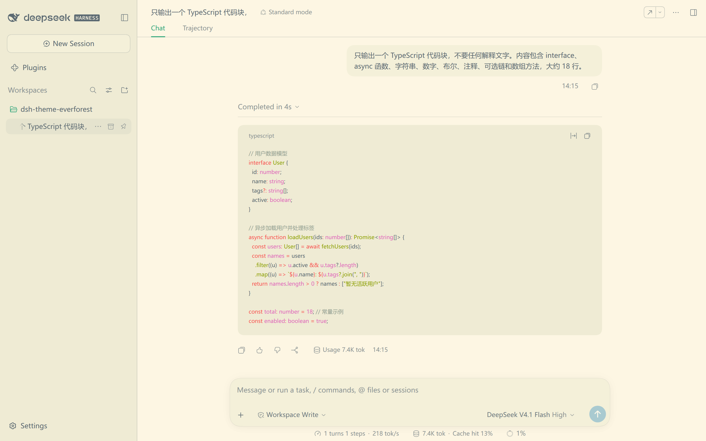
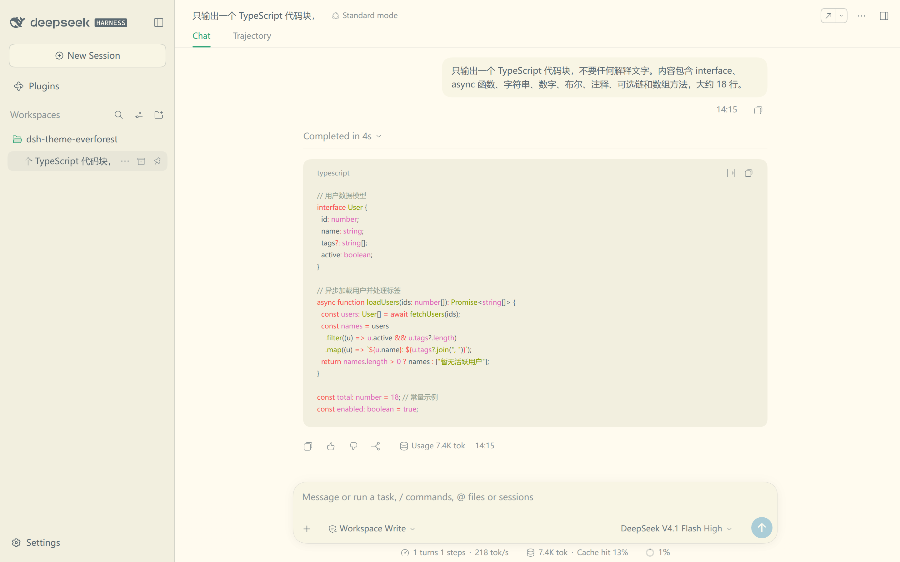
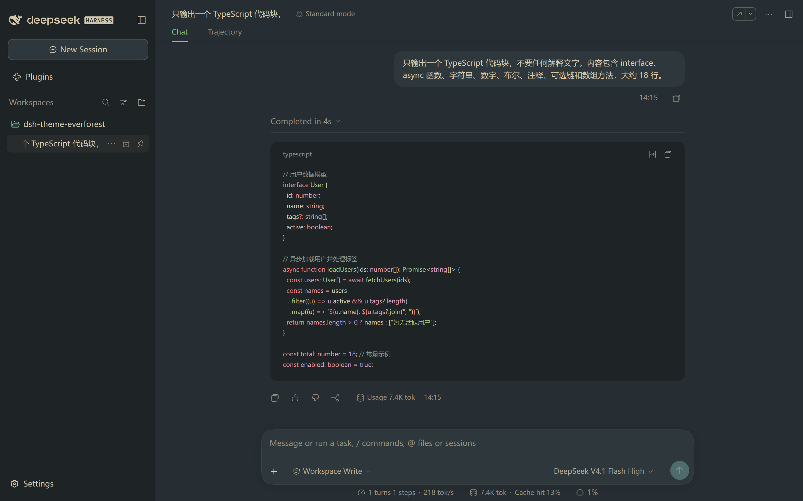
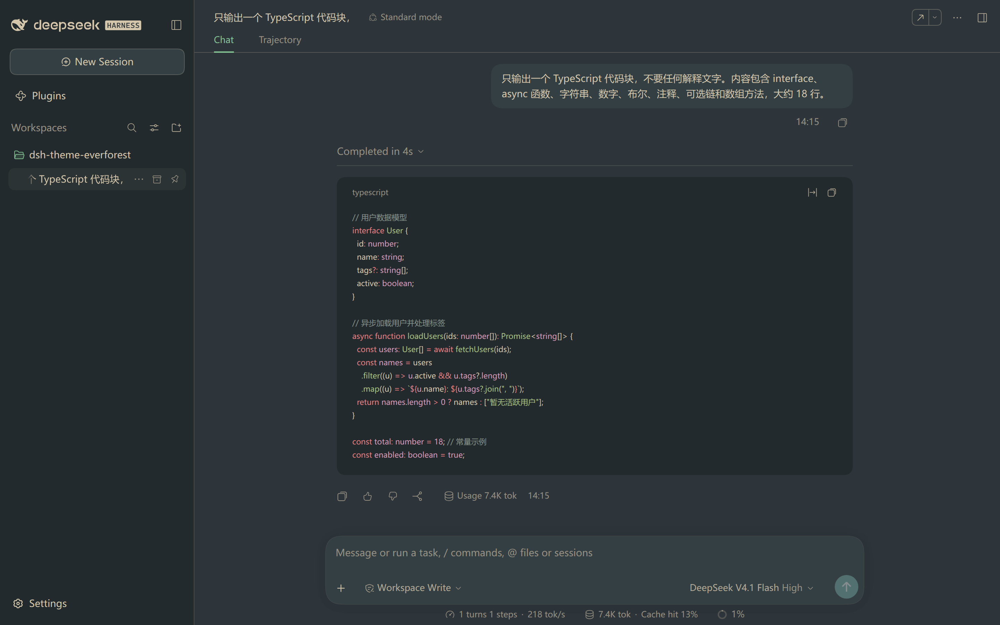
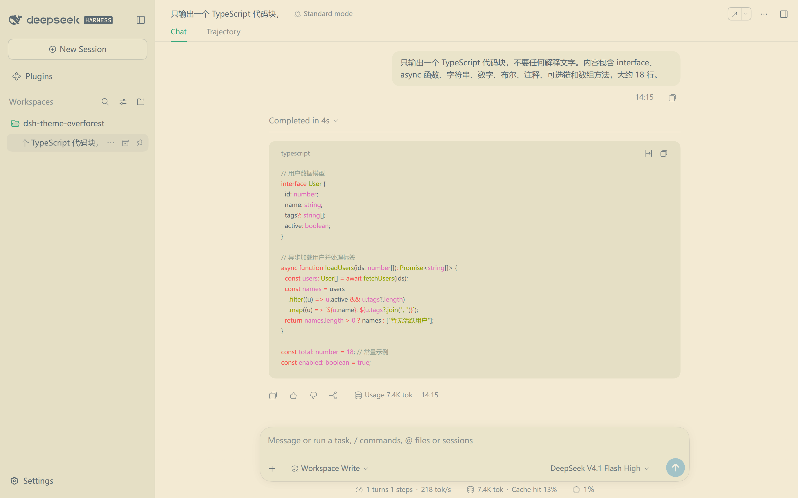
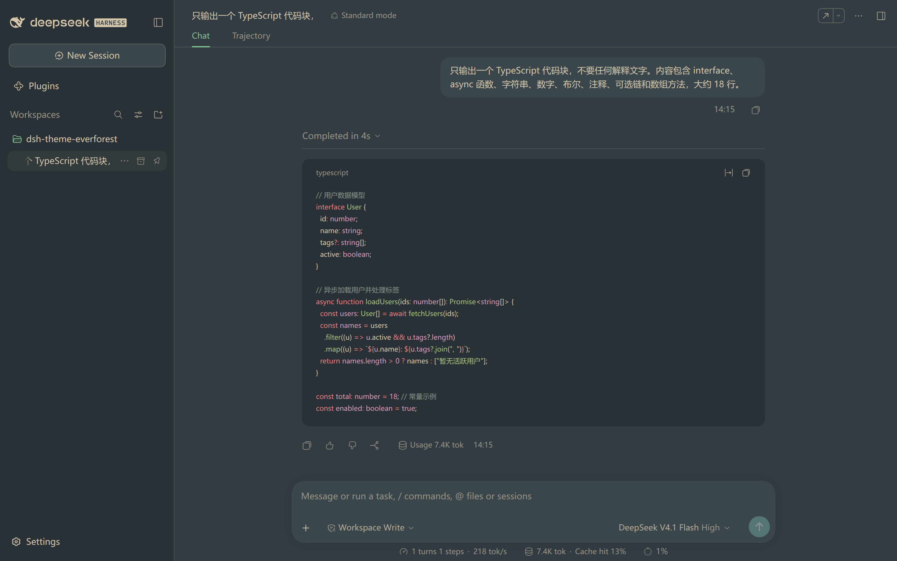

# Everforest for the Harness web interface

Six complete [Everforest](https://github.com/sainnhe/everforest) palettes for the DeepSeek Harness web interface. Each palette pairs a depth (hard, medium or soft) with a plane (light or dark), and one click in Settings applies both.

The pack is a client plugin bundle. The host half is a single loader row with no behavior; the browser half owns the palette token layer and the Settings row. It declares no dependencies and no build step.

Every color comes from the canonical Everforest scheme. The six background ramps are taken from `everforest#get_palette`, and the syntax colors follow the highlight groups in `colors/everforest.vim`. [docs/PALETTE.md](docs/PALETTE.md) records the sources file by file, and [docs/MAPPING.md](docs/MAPPING.md) records how each token is derived.



## Features

The pack repaints every surface the Harness base sheet defines, from the canvas to the code blocks:

- 🌿 **Canonical colors**: accents, greys and the six background ramps come from upstream Everforest, with no hand-tuned values
- 🌓 **Six palettes**: hard, medium and soft, each in a light and a dark plane
- 🎨 **Complete coverage**: all 154 tokens in the Harness base sheet, so the alias, specific and themed-chrome surfaces repaint
- ⌨️ **Syntax included**: code blocks use the Everforest highlight groups rather than the built-in palette
- 🧩 **Nothing to configure**: no dependencies, no install scripts and no host `Config`
- ✅ **Checked**: `tools/check.mjs` verifies coverage, color validity and text contrast for all six palettes

## Palettes

Depth sets the contrast against the canvas, and plane selects the light or dark half of the layer.

| Depth | Light | Dark |
| --- | --- | --- |
| Hard |  |  |
| Medium |  |  |
| Soft |  |  |

Medium is the default. Hard holds the highest text contrast and soft the lowest; [docs/MAPPING.md](docs/MAPPING.md) lists the measured ratios. All six screenshots come from the running web interface, captured in one session at one window size, so the sidebar, the raised surfaces and the code block are directly comparable.

## Install

Install the bundle from a Harness session with the plugin manager:

```text
plugin_manager install_bundle
  target: /path/to/dsh-theme-everforest
```

The target is the absolute path of a clone of this repository.

You can also install it from the Plugin Manager page in the web interface. Point that page at the same directory. The bundle declares no dependencies and runs no install scripts.

Reload the page once after the first install, so the browser half loads. Then open Settings → General → Everforest and pick a depth.

## Choose a palette

The Settings row offers seven choices. Each one sets the depth and the host theme preference together.

| Choice | Effect |
| --- | --- |
| Default | Drops the Everforest layer and returns the built-in palette |
| Dark Hard, Dark Medium, Dark Soft | Paints a dark plane and pins Appearance to Dark |
| Light Hard, Light Medium, Light Soft | Paints a light plane and pins Appearance to Light |

The depth stays in this browser, under `localStorage['dsh-theme-everforest.depth']`, and defaults to `medium`. The plane is the host theme preference, written through `ctx.theme.setTheme`.

The three Appearance choices keep working on their own. Pick System with a depth, and the page follows the operating system: a light plane during the day, a dark plane at night.

## Repository layout

The bundle is one host row plus one browser module, with the palettes and the checks documented alongside:

```text
client.js               palette data, token rules, token layer, settings row
index.js                host half (no behavior)
cordis.patch.yml        inserts the single loader row
icon.svg                Plugin Manager artwork
locale/{en,zh}.json     Plugin Manager title and description
tools/check.mjs         coverage, color, contrast and manifest validator
tools/base-tokens.json  vendored base token list, from the Harness theme bundle
docs/PALETTE.md         upstream palette provenance and the six planes
docs/MAPPING.md         token group to palette slot rules, and contrast tuning
docs/previews/*.png     README screenshots, from the running web interface
```

## Checks

The repository ships no build step. Run three commands:

```sh
node --check client.js          # browser half syntax
node --check index.js           # host half syntax
node tools/check.mjs            # coverage, colors, contrast
```

`tools/check.mjs` loads `client.js` behind a shimmed `window` and validates the generated layers. It compares token coverage against `tools/base-tokens.json`, rejects values that are not CSS colors, and measures text contrast on the base, raised and sidebar surfaces. [docs/MAPPING.md](docs/MAPPING.md) holds the thresholds.

Regenerate the vendored token list after a Harness upgrade changes its theme bundle:

```sh
THEME_PACKAGE=@deepseek-ai/dsh-client-ui-theme
DSH_LIB="$(dirname "$(readlink -f "$(command -v dsh)")")/../node_modules"
node tools/check.mjs --extract \
  --from "$DSH_LIB/@deepseek-ai/dsh/node_modules/@deepseek-ai/$THEME_PACKAGE"
```

The extractor reads `lib/client.js` in that package for the `--dsw-alias-*`, `--dsw-specific-*`, themed-chrome and `--shiki-*` names. It also scans the surrounding packages for `var(--dsw-static-*)` reads, so the static patch list tracks what components consume.

## Known limits

Four limits are worth knowing before you install it:

- **First-paint flash**: the Harness boot stylesheet colors the canvas from the durable scheme before any plugin runs, so the Everforest background appears once this browser module loads. It’s cosmetic, and unavoidable for a per-browser choice.
- **The layer is a default, not an override**: components that shade a token on a deeper selector, such as the Plugin Manager destructive button, keep their own color.
- **Untouched properties**: `--dsw-focus-ring-color` (interaction behavior), shadows, radii and fonts stay as they are. `--dsw-static-neutral-00` and `--dsw-static-neutral-bluish-00` stay pure white, because their consumers use them as a translucent white highlight.
- **Per-browser depth**: the choice lives in this browser origin and does not sync through the profile settings document.

## Credits

- Palette: [sainnhe/everforest](https://github.com/sainnhe/everforest) (MIT), the canonical scheme
- Token mapping, contrast tuning and the settings row: this project

## License

MIT, see the LICENSE file in the repository root. Palette values and the syntax mapping derive from Everforest by sainnhe; [docs/PALETTE.md](docs/PALETTE.md) carries the upstream license text.
